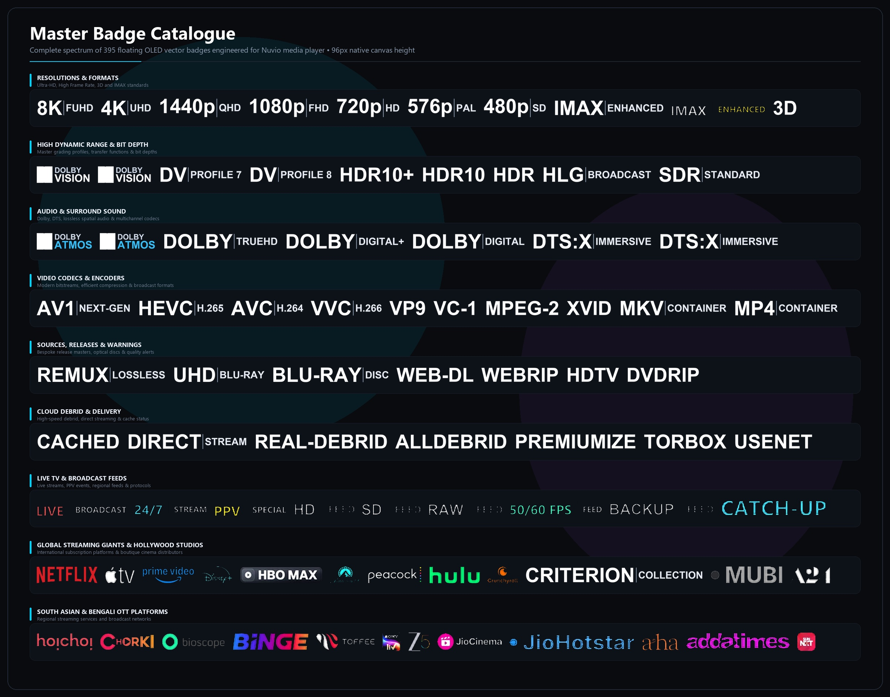
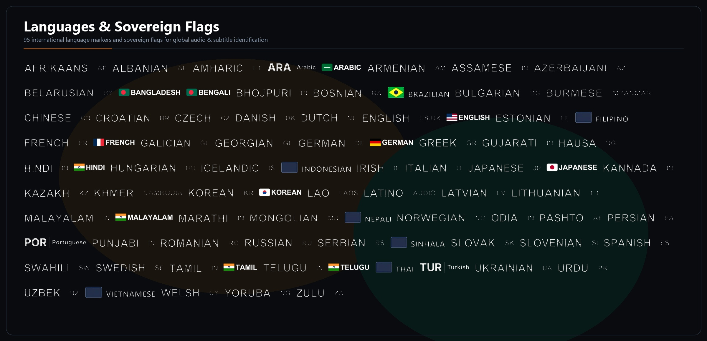

<p align="center">
  
</p>

# Nuvio Badge Kit

395 stream badges in 10 handcrafted styles for Nuvio: quality, HDR, Dolby Vision, Dolby Atmos, audio codecs, 95 world languages and flags, 65+ streaming services and Live TV, plus red warnings for CAM rips and bad copies.

## How to install

1. Pick a style below and copy its link. Each link has all 395 badges, Live TV, and international flags included.
2. In Nuvio, open **Settings → Markers / Badges** (or **Profile → Layout → Streams → Fusion badge URLs**).
3. Paste the link, then open any stream list.

To switch styles later, paste the new link and restart Nuvio.

Language badges always come last in the row, so quality badges stay up front.

## Styles

### Pristine Master


```
https://raw.githubusercontent.com/jayedanik/nuvio-badges/main/badges.json
```

### GMK Custom Keycaps


```
https://raw.githubusercontent.com/jayedanik/nuvio-badges/main/gmk-keycaps.json
```

### Neon RGB Pudding Keycaps


```
https://raw.githubusercontent.com/jayedanik/nuvio-badges/main/rgb-keycaps.json
```

### Royal Golden Cinema Ticket


```
https://raw.githubusercontent.com/jayedanik/nuvio-badges/main/cinema-ticket.json
```

### Cloisonne Enamel Pins


```
https://raw.githubusercontent.com/jayedanik/nuvio-badges/main/enamel-pins.json
```

### 1980s Vintage VHS Tape


```
https://raw.githubusercontent.com/jayedanik/nuvio-badges/main/vhs-tape.json
```

### Cinema Clapperboard


```
https://raw.githubusercontent.com/jayedanik/nuvio-badges/main/clapperboard.json
```

### Audiophile Vintage VFD


```
https://raw.githubusercontent.com/jayedanik/nuvio-badges/main/audiophile-vfd.json
```

### Neo-Tokyo Tech Tag


```
https://raw.githubusercontent.com/jayedanik/nuvio-badges/main/neotokyo-tag.json
```

### Criterion Gold Leather


```
https://raw.githubusercontent.com/jayedanik/nuvio-badges/main/criterion-leather.json
```

## Every badge





## Colours

- **Gold:** the best quality (REMUX, 4K, Dolby Vision, Atmos, Cached).
- **Red:** a warning (CAM, telesync, upscaled, uncached, bad copies).
- **Blue:** resolution and modern video codecs (1080p, 1440p, AV1, HEVC).
- **Purple:** immersive multichannel audio (Dolby Atmos, DTS:X, TrueHD).
- **Green:** direct playback, lossless audio, and multi-language streams.

## Performance

- **96px Native Canvas Height:** Pre-rendered to match Nuvio's internal layout grid with zero runtime scaling penalty.
- **Lightweight WebP:** Optimized to ~3.5 KB average per badge for instantaneous loading.
- **Zero-Lag Loading:** An entire stream row loads under 50 KB of total data.

## Something wrong?

- **No badges:** check the link starts with `raw.githubusercontent.com`, then restart Nuvio.
- **Badges look old or cached:** paste your link again in Nuvio to refresh the cache.
- **A badge is wrong or missing:** [open an issue](https://github.com/jayedanik/nuvio-badges/issues) with the stream's full title.

## Credits

Designed with care for the Nuvio community. Fonts: JetBrains Sans. Tag research from TRaSH Guides and AIOStreams. Not affiliated with Dolby, DTS, IMAX, or any streaming service. Released under the MIT licence.
