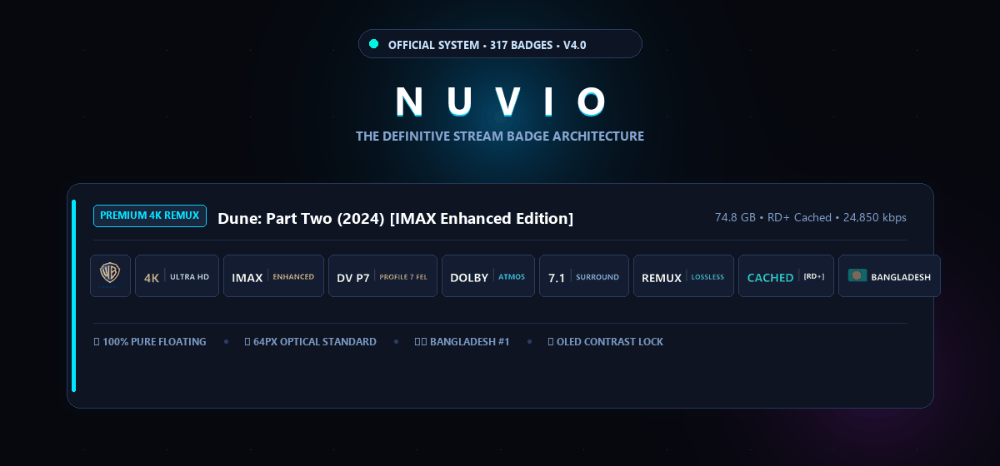
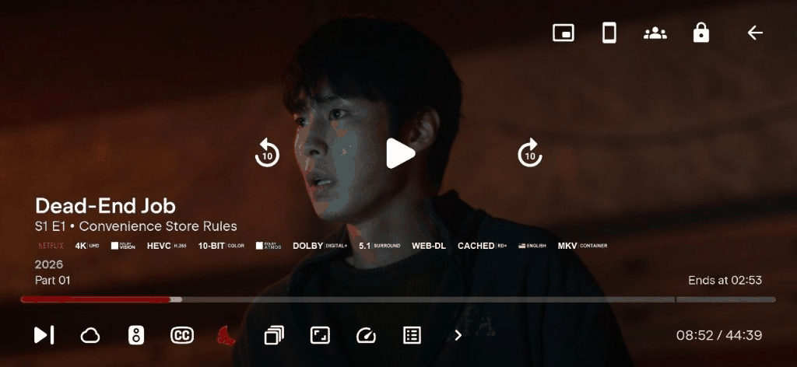
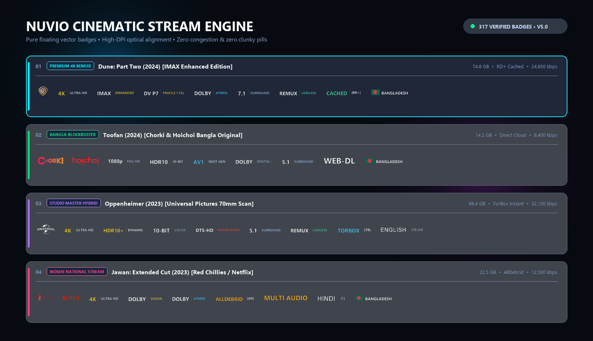

<p align="center">
  
</p>

<p align="center">
  <a href="https://github.com/jayedanik/nuvio-badges"></a>
  <a href="badges.json"></a>
  <a href="#-optical-area-balancing-standard"></a>
  <a href="#-bangladeshi--bengali-ott-coverage"></a>
  <a href="LICENSE"></a>
</p>

---

## ⚡ 1-Click Instant Setup for Nuvio

Copy and paste this URL directly into **Nuvio Player Settings ➔ Markers / Badges**:

```text
https://raw.githubusercontent.com/jayedanik/nuvio-badges/main/badges.json
```

> **Pro Tip:** Nuvio automatically caches and synchronizes badge definitions dynamically. Once configured, every stream title across movies, series, anime, and live IPTV will render with pure floating vector badges.

---

## 🎬 Live Interactive Player Demonstration

Experience the seamless stream selection flow in Nuvio with zero clipping, perfect horizontal margins, and dynamic focus illumination:

<p align="center">
  
</p>

---

## 💎 The Cinematic OLED Presentation

<p align="center">
  
</p>

---

## 🌟 The Studio & Platform Ecosystem

Every platform and film studio logo is meticulously color-calibrated with **pure vector contrast tuning**—ensuring absolute, crystal-clear readability over dark OLED backgrounds with zero clunky pill boxes.

<p align="center">
  
</p>

---

## 🚀 Radical Upgrades in V5.0

### 1. 📐 Mathematical Optical Area Balancing (Zero Congestion & Strict Margins)
- **Eliminated the 12x Size Disparity:** Previously, square emblems (like WB shield, DC circle, Apple logo, T-Series) were shrunken to 22px specks, while wide wordmarks expanded to 266px giant blocks.
- **Dynamic Optical Curve:** 
  - Square emblems ($1:1$) are rendered at **48px** visual height.
  - Standard logos ($2:1$) are rendered at **40px** visual height.
  - Wide wordmarks ($3.5:1+$) are rendered at **30–34px** visual height.
- **Result:** Every badge occupies an optically balanced perceived visual area. Wide titles no longer dominate, and square emblems no longer look tiny.
- **Unified 64px Canvas:** All 373 badges are generated on an exact **64px high-DPI canvas** with generous horizontal padding (minimum 8px on each side) to guarantee that badges never collide or appear congested.
- **Strict Layout Guarantees:** Every preview card strictly bounds titles and badge rows, ensuring a minimum of **120px+ safety margin** before the container boundary.

### 2. 🌓 OLED Dark-Mode Contrast Engine
- Converted all 19+ pure-black silhouettes (A24, Universal, Pixar, Lucasfilm, Columbia, Disney Castle, DreamWorks, 20th Century Studios, Lionsgate, Blumhouse, Studio Ghibli, Focus Features, Searchlight, Legendary, Channel 4, DAZN) into **brilliant crisp pure white (`#FFFFFF`)**.
- Brand logos with colored accents (Peacock, Aha, Toffee, Binge BD, DeeptoPlay, JioCinema, SonyLIV, KLIKK) have their lettering illuminated in white while preserving vibrant corporate colors.

### 3. 🇧🇩 Bangladesh (#1 Priority) & Complete South Asian OTT Architecture
- **Bangladesh Flag (🇧🇩) Ranked #1** at the very top of the national languages and flags section with the constitutional 45% offset crimson disk on bottle green.
- **Complete Bangladeshi & Bengali OTT Coverage:** Hoichoi (`HC`, `HC.WEB-DL`), Chorki, Toffee, Binge BD, Bioscope, Bongo BD, DeeptoPlay, Banglaflix, Cinematic BD, RabbitholeBD, KLIKK, Addatimes, SVF Entertainment, and Jaaz Multimedia.
- **Indian National & Regional OTT Services:** JioHotstar, JioCinema, Zee5, SonyLIV, Sun NXT, Aha Video, MX Player, Eros Now, Hungama Play, ALTT, Ullu, ShemarooMe, ManoramaMAX, Chaupal, Stage, Yash Raj Films (YRF), Dharma Productions, Red Chillies Entertainment, and T-Series.

---

## 🏛️ StreamBridge Golden Serial Hierarchy

Badges follow the authentic **StreamBridge Golden Sequence**, organizing metadata logically from source to release flags:

```text
[Platform / Studio] ➔ [Resolution] ➔ [HDR / IMAX] ➔ [Video Codec] ➔ [Bit-Depth] ➔ [Frame Rate] ➔ [Audio] ➔ [Channels] ➔ [Source] ➔ [Edition] ➔ [Delivery] ➔ [Country / Flag] ➔ [Subtitles] ➔ [Flags] ➔ [Container] ➔ [Live]
```

| Order | Group ID | Category | Key Highlights |
|:---:|:---|:---|:---|
| **01** | `service` | **Streaming & Studios** | Hollywood Majors, South Asian OTTs, Global Streamers, Japanese Anime |
| **02** | `resolution` | **Resolution** | 8K UHD, 4K UHD, 1440p QHD, 1080p FHD, 720p HD, 576p, 480p SD |
| **03** | `hdr` | **HDR & Dynamic Range** | Dolby Vision (P5/P7/P8), HDR10+, HDR10, HLG, SDR, IMAX Enhanced, 3D |
| **04** | `codec` | **Video Codecs** | AV1 Next-Gen, VVC (H.266), HEVC (H.265), AVC (H.264), VP9, VC-1, MPEG-2 |
| **05** | `bit-depth` | **Color Bit Depth** | 10-Bit Studio Color, 12-Bit Cinema Master, 8-Bit Standard |
| **06** | `framerate` | **Frame Rate** | 120 FPS, 60 FPS High-Motion, 50 FPS PAL, HFR Cinema |
| **07** | `audio` | **Audio Formats** | Dolby Atmos, Dolby TrueHD, Dolby Digital Plus, DTS:X, DTS-HD MA, FLAC, AAC |
| **08** | `channels` | **Audio Channels** | 7.1 Surround, 6.1 Surround, 5.1 Surround, 2.0 Stereo, 1.0 Mono |
| **09** | `source` | **Source & Rip Type** | REMUX (Lossless), Full Disc, UHD Blu-ray, Blu-ray, WEB-DL, WEBRip, HDTV |
| **10** | `edition` | **Editions & Cuts** | Director's Cut, Extended Cut, Theatrical, Criterion, Remastered, IMAX, Hybrid |
| **11** | `delivery` | **Debrid & Delivery** | Cached [RD+], Real-Debrid, TorBox, AllDebrid, Premiumize, USENET, P2P |
| **12** | `language` | **Audio Languages & Flags** | **Bangladesh (🇧🇩) #1**, India (🇮🇳 Hindi, Tamil, Telugu, etc.), Global |
| **13** | `subtitles` | **Subtitles** | Embedded Subs (ESub), Multi-Subs (MSubs), SDH Hearing Impaired, Forced Subs |
| **14** | `flags` | **Release Flags** | PROPER, REPACK, INTERNAL, LIMITED, Season Pack, Anime Batch v2 |
| **15** | `container` | **Containers** | MKV, MP4, M2TS, AVI |
| **16** | `live` | **Live TV & Feeds** | LIVE, 24/7 Streams, PPV Event, HD/SD Feeds, Catch-up TV |

---

## 📂 Detailed Badge Catalog Breakdown

<details>
<summary><b>🎬 Click to expand Hollywood Majors & International Studios (19 Badges)</b></summary>

- **Warner Bros. Pictures** (`warnerbros.webp`) — Official 2023 Shield
- **Universal Pictures** (`universal.webp`) — Globe and typography in crisp white
- **Paramount Pictures** (`paramount_studio.webp`) — Mountain peak and stars in ice white
- **Columbia Pictures** (`columbia.webp`) — Sony Columbia wordmark in pure white
- **Walt Disney Pictures** (`disney_studio.webp`) — Cinderella Castle & script in pure white
- **Marvel Studios** (`marvel.webp`) — Iconic red box with white MARVEL + STUDIOS
- **DC Studios** (`dc.webp`) — James Gunn DC circle emblem in crisp white
- **Pixar Animation** (`pixar.webp`) — Wordmark in pure white
- **Lucasfilm** (`lucasfilm.webp`) — Wordmark in pure white
- **20th Century Studios** (`century_fox.webp`) — Horizontal monument in pure white
- **DreamWorks Animation** (`dreamworks.webp`) — Crescent moon fishing boy in pure white
- **Lionsgate** (`lionsgate.webp`) — Wordmark in pure white
- **A24** (`a24.webp`) — Minimalist emblem in pure white
- **NEON** (`neon.webp`) — Glowing typographic wordmark
- **Blumhouse** (`blumhouse.webp`) — Wordmark in pure white
- **Studio Ghibli** (`ghibli.webp`) — Totoro silhouette in pure white
- **Focus Features** (`focus.webp`) — Typography in pure white
- **Searchlight Pictures** (`searchlight.webp`) — Typography in pure white
- **Legendary Entertainment** (`legendary.webp`) — Celtic knot in pure white
</details>

<details>
<summary><b>🇧🇩 Click to expand Bangladeshi & Bengali OTT Platforms (14 Badges)</b></summary>

- **Hoichoi** (`hoichoi.webp`) — Full regex matching `HC`, `HC.WEB-DL`, `[HC]`, `hmp`
- **Chorki** (`chorki.webp`) — Official yellow/orange circle star C emblem
- **Toffee** (`toffee.webp`) — Beximco Toffee bright red curve & white typography
- **Binge BD** (`bingebd.webp`) — Red & yellow play badge with white typography
- **Bioscope** (`bioscope.webp`) — Grameenphone Bioscope multi-colored aperture
- **Bongo BD** (`bongo.webp`) — Red B play button
- **DeeptoPlay** (`deeptoplay.webp`) — Sunburst emblem with illuminated lettering
- **Banglaflix** (`banglaflix.webp`) — Film reel emblem
- **Cinematic BD** (`cinematic.webp`) — Clapboard emblem
- **RabbitholeBD** (`rabbithole.webp`) — White rabbit emblem in blue circle
- **KLIKK** (`klikk.webp`) — Electric magenta K symbol
- **Addatimes** (`addatimes.webp`) — Gold/yellow emblem
- **SVF Entertainment** (`svf.webp`) — Red/blue emblem
- **Jaaz Multimedia** (`jaaz.webp`) — Golden wings crown emblem
</details>

<details>
<summary><b>🇮🇳 Click to expand Indian National & Regional Platforms (19 Badges)</b></summary>

- **JioHotstar** (`jiohotstar.webp`) — JioHotstar star badge
- **JioCinema** (`jiocinema.webp`) — Magenta/pink emblem with crisp white typography
- **Zee5** (`zee5.webp`) — Multi-colored ring with ZEE5 typography
- **SonyLIV** (`sonyliv.webp`) — Colorful geometric stripes with pure white LIV
- **Sun NXT** (`sunnxt.webp`) — Sun burst emblem
- **Aha Video** (`aha.webp`) — Official vibrant orange (`#F46C33`)
- **MX Player** (`mxplayer.webp`) — Blue play shield with crisp white typography
- **Eros Now** (`erosnow.webp`) — Magenta wordmark
- **Hungama Play** (`hungama.webp`) — Vibrant orange emblem with white lettering
- **ALTT** (`altt.webp`) — Red/white ALTT emblem
- **Ullu** (`ullu.webp`) — Yellow owl emblem
- **ShemarooMe** (`shemaroome.webp`) — Multi-colored ribbon emblem
- **ManoramaMAX** (`manoramamax.webp`) — Orange/blue emblem with white max lettering
- **Chaupal** (`chaupal.webp`) — Gold/red emblem
- **Planet Marathi** (`planetmarathi.webp`) — Orange planet ring emblem
- **Stage** (`stage.webp`) — Dial emblem with white lettering
- **Yash Raj Films** (`yrf.webp`) — YRF wings in gold/white
- **Dharma Productions** (`dharma.webp`) — Dharma D triangle
- **Red Chillies Entertainment** (`redchillies.webp`) — Red sword/chili emblem
- **T-Series Films** (`tseries.webp`) — Red T circular emblem
</details>

---

## 🛠️ Maintained By

Engineered with ❤️ by [@jayedanik](https://github.com/jayedanik).  
Contributions and issue reports are warmly welcomed!
