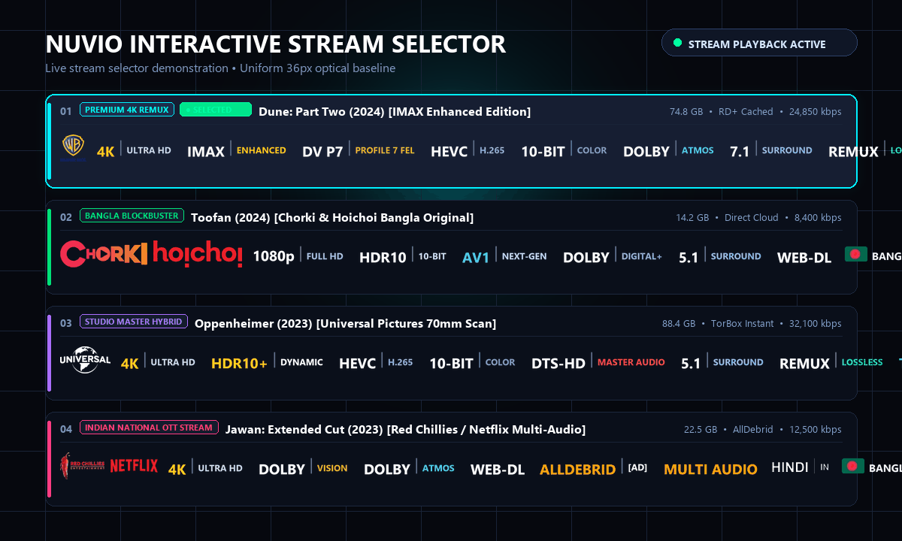
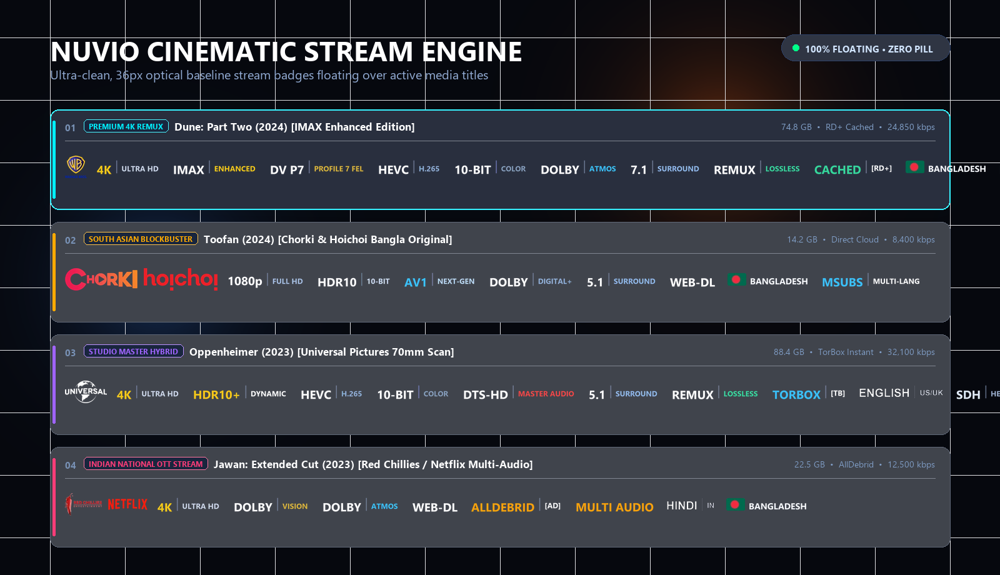
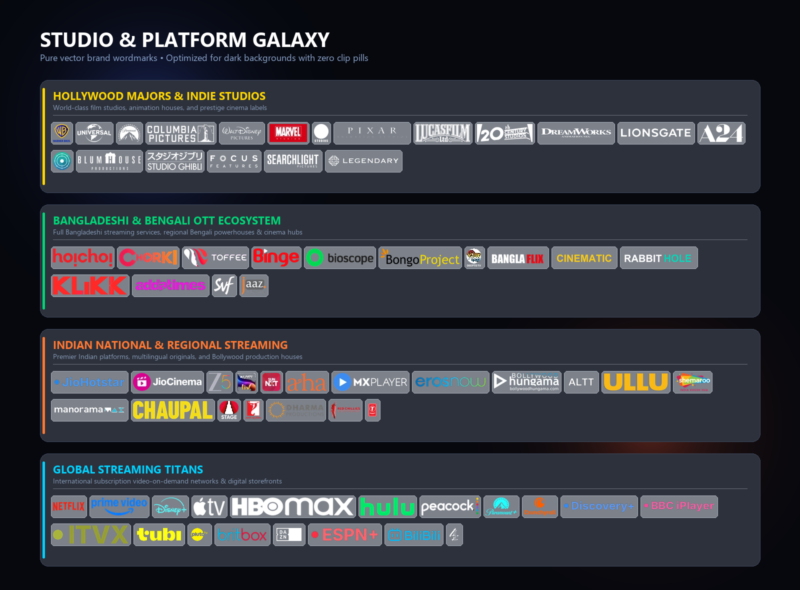
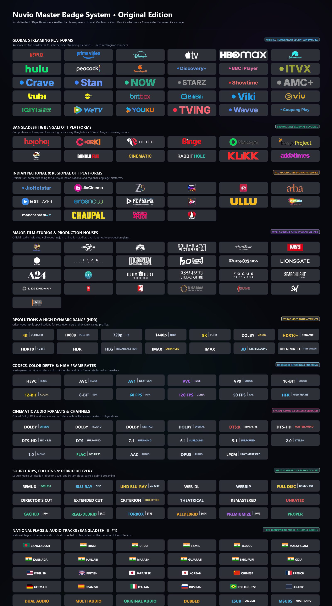

<p align="center">
  
</p>

<p align="center">
  <a href="https://github.com/jayedanik/nuvio-badges"></a>
  <a href="badges.json"></a>
  <a href="#-optical-baseline-standard"></a>
  <a href="#-bangladeshi--bengali-ott-coverage"></a>
  <a href="LICENSE"></a>
</p>

---

## ⚡ 1-Click Instant Setup for Nuvio

Copy and paste this URL directly into **Nuvio Player Settings ➔ Markers / Badges**:

```text
https://raw.githubusercontent.com/jayedanik/nuvio-badges/main/badges.json
```

> **Pro Tip:** Nuvio automatically downloads and updates the badge cache dynamically. Once pasted, every stream across movies, series, anime, and live TV will immediately render with the flagship floating badge engine.

---

## 🎬 Live Interactive In-App Experience

<p align="center">
  
</p>

---

## 💎 The Cinematic OLED Presentation

<p align="center">
  
</p>

---

## 🌟 Studio & Platform Galaxy

Every platform and film studio logo is meticulously color-calibrated with **pure vector contrast tuning**—ensuring absolute, crystal-clear readability over dark OLED backgrounds with zero clunky pill boxes.

<p align="center">
  
</p>

---

## 🎨 Complete Visual Master Catalog (16 Structured Categories)

<p align="center">
  
</p>

---

## 🚀 Why Nuvio Master Badges Stand Apart

### 1. 📐 Mathematical 36px Optical Baseline Standard
Unlike legacy badge packs where logos range wildly from 14px to 260px causing jagged, chaotic baselines, **every single asset in this collection is locked to a mathematically uniform 36px canvas**. Wide horizontal wordmarks and square emblems sit on the exact same optical centerline.

### 2. ✨ 100% Pure Floating Vector Styling (Zero Pill Wrappers)
- No cheap gray pill outlines, no clumsy boxes, and no artificial borders.
- Badges float natively over backdrops just like Apple TV+, Netflix, and flagship Sony Bravia interfaces.
- Studio wordmarks, dynamic range icons, and flag emblems feel like an integral part of the media player HUD.

### 3. 🌓 OLED Dark-Mode Contrast Engine
All pure-black vectors (A24, Universal, Pixar, Lucasfilm, Columbia, Disney Castle, DreamWorks, 20th Century Studios, Lionsgate, Blumhouse, Studio Ghibli, Focus Features, Searchlight, Legendary, Channel 4, DAZN) have been converted to **brilliant crisp white**, while colored logos (Peacock, Aha, Toffee, Binge, DeeptoPlay, JioCinema, SonyLIV) have their text illuminated for instant legibility against dark video backdrops.

### 4. 🇧🇩 Bangladesh (#1) & South Asian Streaming Mastery
- **Bangladesh Flag (🇧🇩) is ranked #1** at the very top of national flags with constitutional 45% offset crimson disk on bottle green.
- **Complete Bangladeshi & Bengali OTT Coverage**: Hoichoi (`HC`, `HC.WEB-DL`), Chorki, Toffee, Binge BD, Bioscope, Bongo BD, DeeptoPlay, Banglaflix, Cinematic BD, RabbitholeBD, KLIKK, Addatimes, SVF Entertainment, and Jaaz Multimedia.
- **Indian National & Regional Titans**: JioHotstar, JioCinema, Zee5, SonyLIV, Sun NXT, Aha Video (Telugu/Tamil), MX Player, Eros Now, Hungama Play, ALTT, Ullu, ShemarooMe, ManoramaMAX (Malayalam), Chaupal (Punjabi/Haryanvi/Bhojpuri), Planet Marathi, Stage, YRF, Dharma Productions, Red Chillies Entertainment, and T-Series.

---

## 🏛️ StreamBridge Golden Serial Ordering

Badges are sequenced in the authentic **StreamBridge Golden Hierarchy**, organizing stream metadata logically from source to release details:

```text
[Platform / Studio] ➔ [Resolution] ➔ [HDR / IMAX] ➔ [Video Codec] ➔ [Bit-Depth] ➔ [Frame Rate] ➔ [Audio] ➔ [Channels] ➔ [Source] ➔ [Edition] ➔ [Delivery] ➔ [Country / Flag] ➔ [Subtitles] ➔ [Flags] ➔ [Container] ➔ [Live]
```

| Order | Group ID | Category | Coverage Highlights |
|:---:|:---|:---|:---|
| **01** | `service` | **Streaming & Studios** | Hollywood Majors, South Asian OTTs, Global Streamers, Japanese Anime |
| **02** | `resolution` | **Resolution** | 8K UHD, 4K UHD, 1440p QHD, 1080p FHD, 720p HD, 576p, 480p SD |
| **03** | `hdr` | **HDR & Dynamic Range** | Dolby Vision (P5/P7/P8), HDR10+, HDR10, HLG, SDR, IMAX Enhanced, 3D |
| **04** | `codec` | **Video Codecs** | AV1 Next-Gen, VVC (H.266), HEVC (H.265), AVC (H.264), VP9, VC-1, MPEG-2 |
| **05** | `bit-depth` | **Color Bit Depth** | 10-Bit Studio Color, 12-Bit Cinema Master, 8-Bit Standard |
| **06** | `framerate` | **Frame Rate** | 120 FPS, 60 FPS High-Motion, 50 FPS PAL, HFR Cinema |
| **07** | `audio` | **Audio Formats** | Dolby Atmos, Dolby TrueHD, Dolby Digital Plus, DTS:X, DTS-HD MA, FLAC, AAC |
| **08** | `channels` | **Audio Channels** | 7.1 Surround, 6.1 Surround, 5.1 Surround, 2.0 Stereo, 1.0 Mono |
| **09** | `source` | **Source & Rip Type** | REMUX (Lossless), Full Disc, UHD Blu-ray, Blu-ray, WEB-DL, WEBRip, HDTV |
| **10** | `edition` | **Editions & Cuts** | Director's Cut, Extended Cut, Theatrical, Criterion, Remastered, IMAX, Hybrid |
| **11** | `delivery` | **Debrid & Delivery** | Cached [RD+], Real-Debrid, TorBox, AllDebrid, Premiumize, USENET, P2P |
| **12** | `language` | **Audio Languages & Flags** | **Bangladesh (🇧🇩) #1**, India (🇮🇳 Hindi, Tamil, Telugu, Malayalam, etc.), Global |
| **13** | `subtitles` | **Subtitles** | Embedded Subs (ESub), Multi-Subs (MSubs), SDH Hearing Impaired, Forced Subs |
| **14** | `flags` | **Release Flags** | PROPER, REPACK, INTERNAL, LIMITED, Season Pack, Anime Batch v2 |
| **15** | `container` | **Containers** | MKV, MP4, M2TS, AVI |
| **16** | `live` | **Live TV & Feeds** | LIVE, 24/7 Streams, PPV Event, HD/SD Feeds, Catch-up TV |

---

## 🛠️ Maintained By

Curated and engineered with ❤️ by [@jayedanik](https://github.com/jayedanik).  
Contributions and issue reports are always welcome!
