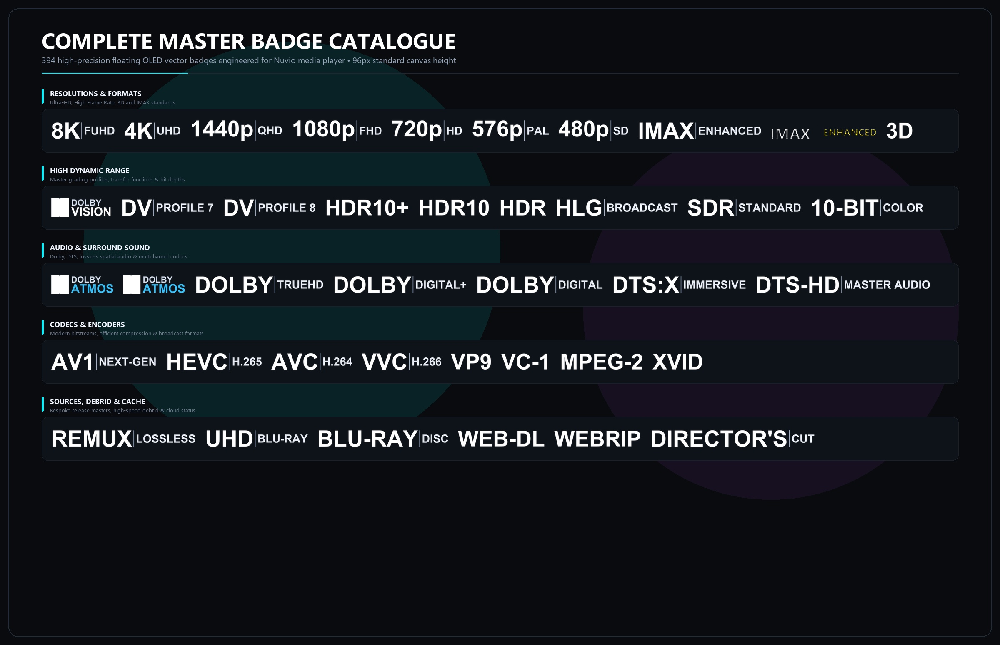
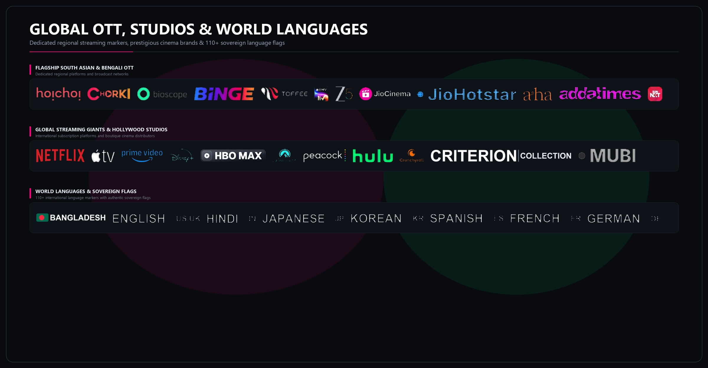

<p align="center">
  
</p>

<p align="center">
  <a href="https://github.com/jayedanik/nuvio-badges"></a>
  <a href="badges.json"></a>
  <a href="badges.json"></a>
  <a href="badges.json"></a>
  <a href="LICENSE"></a>
</p>

<p align="center">
  <strong>394 stream badges in 10 handcrafted styles for Nuvio</strong><br/>
  Quality, HDR, Dolby Vision, Dolby Atmos, Audio Codecs, 110+ World Languages & Flags, 65+ Global & Regional OTT Services, and Debrid Cache status — engineered for pure zero-lag playback.
</p>

---

## ⚡ How to install

1. **Pick a style below** and copy its direct manifest link. Each link includes all 394 stream badges with automated fallback.
2. In Nuvio, open **Settings → Markers / Badges** *(or **Profile → Layout → Streams → Fusion badge URLs**)*.
3. **Paste the link**, then open any movie or series stream list.

> 💡 **To switch styles later:** Simply paste a new link from below and restart Nuvio.

---

## 🎨 Styles

### 🌟 Pristine Master (Default)
Ultra-clean floating OLED vector typography with micro-subtitles and official Dolby branding. 100% background-free.


```
https://raw.githubusercontent.com/jayedanik/nuvio-badges/main/badges.json
```

---

### ⌨️ Theme 1: GMK Custom Keycaps
Classic dark PBT mechanical hardware with spherical scoops, accent keycaps, and tactile angled skirt drop shadows.


```
https://raw.githubusercontent.com/jayedanik/nuvio-badges/main/gmk-keycaps.json
```

---

### 🌈 Theme 2: Neon RGB Pudding Keycaps
Translucent milky pudding keycaps with intense dynamic RGB underglow, dual-tone key stems, and cybernetic neon edge lighting.


```
https://raw.githubusercontent.com/jayedanik/nuvio-badges/main/rgb-keycaps.json
```

---

### 🎟️ Theme 3: Royal Golden Cinema Ticket
Vintage Broadway Hollywood premiere ticket stub with 24K double gold pinstripes, corner diamond inlays, and authentic semicircular side notches.


```
https://raw.githubusercontent.com/jayedanik/nuvio-badges/main/cinema-ticket.json
```

---

### 🏅 Theme 4: Cloisonné Enamel Jewelry Pins
Handcrafted jewelry aesthetic with cast 3D brass metal borders, liquid jewelry enamel pool, and diagonal specular glass shine.


```
https://raw.githubusercontent.com/jayedanik/nuvio-badges/main/enamel-pins.json
```

---

### 📼 Theme 5: 1980s Vintage VHS Tape
Retro analog video store aesthetic with warm aged matte paper, left vertical barcode stamp, and classic 80s tri-color rainbow spine stripe.


```
https://raw.githubusercontent.com/jayedanik/nuvio-badges/main/vhs-tape.json
```

---

### 🎬 Theme 6: Hollywood Cinema Clapperboard
Iconic film set production slate with bold black & white chevron clapper sticks, matte blackboard texture, and dual metal hinge bolts.


```
https://raw.githubusercontent.com/jayedanik/nuvio-badges/main/clapperboard.json
```

---

### 📟 Theme 7: Audiophile Vintage VFD Display
High-end McIntosh-style hi-fi audio rack with brushed aluminium chassis, smoked glass window, and glowing teal vacuum fluorescent display characters.


```
https://raw.githubusercontent.com/jayedanik/nuvio-badges/main/audiophile-vfd.json
```

---

### 🏷️ Theme 8: Neo-Tokyo Minimalist Tech Tag
Acronym cyberpunk garment tag with high-contrast accent border, futuristic monospace typography, and clean HUD spec layout.


```
https://raw.githubusercontent.com/jayedanik/nuvio-badges/main/neotokyo-tag.json
```

---

### 💎 Theme 9: Criterion 24K Gold Foil Leather
Luxury boutique physical release with midnight leather grain texture, 24K gold foil debossed frame, and corner diamond accents.


```
https://raw.githubusercontent.com/jayedanik/nuvio-badges/main/criterion-leather.json
```

---

## 📺 Complete Master Badge Catalogue

Explore the complete catalog of 394 high-precision badges covering all modern home theater specs:

<p align="center">
  
</p>

### 🌐 Global & Regional OTT Services, Cinema Studios & 110+ Flags

<p align="center">
  
</p>

---

## 🎨 Color & Quality Hierarchy

- **Gold / Amber:** Premium top-tier sources (`REMUX`, `4K UHD`, `Dolby Vision`, `Dolby Atmos`, `CACHED`).
- **Cyan / Electric Blue:** High-definition video streams and modern codecs (`1080p`, `1440p`, `AV1`, `HEVC`).
- **Violet / Purple:** Immersive multi-channel surround sound (`Dolby Atmos`, `DTS:X`, `TrueHD`, `7.1`).
- **Emerald / Green:** Direct high-speed playback, multi-language packs, and lossless audio (`DIRECT`, `FLAC`, `MULTI`).
- **Red / Coral:** Warnings & quality alerts (`CAM`, `Telesync`, `Screener`, `UNCACHED`).

---

## 🚀 Performance & Zero-Lag Architecture

Every single badge in this repository is engineered specifically for Nuvio:
- **96px Native Canvas Height:** Pre-rendered to match Nuvio's internal layout grid, eliminating runtime GPU/CPU resizing overhead.
- **Feather-Light WebP:** Compressed to ~3.5 KB average per badge with 92% lossy quantization for pristine vector-like fidelity at negligible file size.
- **Instant Stream Loading:** An entire row of 12 stream badges loads under 50 KB total data, ensuring instantaneous UI rendering without player stutter or memory leaks.
- **Smart Automated Fallback:** Custom themes style all video, audio, codec, source, and cache specs while seamlessly falling back to high-resolution vector logos for obscure regional channels and studios.

---

## 💎 Master Badge Ecosystem

<details>
<summary><strong>📺 Click to view complete badge catalog breakdown (394 Badges)</strong></summary>

### 1. Resolutions & Formats
`4K UHD`, `8K UHD`, `1440p QHD`, `1080p FHD`, `720p HD`, `576p SD`, `480p SD`, `3D (OU, SBS, MVC)`, `IMAX`, `IMAX Enhanced`, `High Frame Rate (HFR, 60fps, 120fps)`.

### 2. High Dynamic Range
`Dolby Vision (Single & Dual Layer Profile 7/8)`, `HDR10+`, `HDR10`, `HLG`, `SDR`, `10-Bit`, `12-Bit Color`.

### 3. Audio & Spatial Sound
`Dolby Atmos`, `Dolby Digital Plus (DDP / E-AC3)`, `Dolby TrueHD`, `DTS:X`, `DTS-HD Master Audio`, `DTS-HD HRA`, `FLAC Lossless`, `LPCM`, `AAC`, `Opus`, `Channel Configurations (1.0, 2.0, 5.1, 7.1)`.

### 4. Video Codecs & Encoders
`AV1`, `HEVC (H.265)`, `AVC (H.264)`, `VVC (H.266)`, `VP9`, `VC-1`, `MPEG-2`, `XviD`.

### 5. Media Sources & Releases
`REMUX (4K & Blu-ray)`, `Blu-ray Disc`, `UHD Blu-ray`, `WEB-DL`, `WEBRip`, `HDTV`, `DVD-Rip`, `Director's Cut`, `Theatrical Cut`, `Extended Edition`, `Remastered`, `Unrated`.

### 6. Cloud Debrid & Cache Status
`Cached (Real-Debrid, AllDebrid, Premiumize, TorBox)`, `Uncached`, `Direct Stream`, `P2P`.

### 7. Flagship South Asian & Regional OTT
`Hoichoi`, `Chorki`, `Bioscope`, `Binge BD`, `Toffee`, `SonyLIV`, `Zee5`, `JioCinema`, `JioHotstar`, `Aha`, `Addatimes`, `SunNXT`, `KLiKK`, `ManoramaMAX`, `Planet Marathi`, `Chaupal`.

### 8. Global Streaming Giants & Hollywood Studios
`Netflix`, `Apple TV+`, `Prime Video`, `Disney+`, `HBO Max`, `Paramount+`, `Peacock`, `Hulu`, `Crunchyroll`, `Criterion Collection`, `MUBI`, `A24`, `Marvel Studios`, `Lucasfilm`, `Warner Bros.`, `Universal Pictures`, `Columbia Pictures`.

### 9. 110+ World Languages & Sovereign Flags
`Bengali`, `Hindi`, `English`, `Japanese`, `Korean`, `Spanish`, `French`, `German`, `Italian`, `Russian`, `Arabic`, `Tamil`, `Telugu`, `Malayalam`, `Kannada`, `Punjabi`, `Marathi`, `Gujarati`, and more with sovereign flag markers.

</details>

---

## 🛠️ Something Wrong or Need Help?

- **Badges not showing up?** Ensure your manifest link starts with `https://raw.githubusercontent.com/...` and restart Nuvio.
- **Badges look old or cached?** Re-paste your chosen style URL in Nuvio Settings to refresh the local cache.
- **A badge is missing or wrong?** [Open an Issue](https://github.com/jayedanik/nuvio-badges/issues) with the stream's full release name.

---

## 📄 License & Credits

Released under the **MIT License**. Crafted with precision and luxury for the Nuvio community.
