<p align="center">
  
</p>

<p align="center">
  <a href="https://github.com/jayedanik/nuvio-badges"></a>
  <a href="badges.json"></a>
  <a href="badges.json"></a>
  <a href="#-performance-architecture"></a>
  <a href="LICENSE"></a>
</p>

<p align="center">
  <sub>Next-gen floating vector badges for Nuvio media player — 394 custom badges across 65+ streaming services, cinema studios, 4K/8K formats, immersive audio, and 110+ world countries & languages.<br/>Engineered for pure background-free playback, zero loading lag (only 2.6 MB total footprint), and seamless TV/PC legibility.</sub>
</p>

---

### 📑 Quick Navigation

* [⚡ Quick Setup](#-quick-setup)
* [🎬 Live Player Experience](#-live-player-experience)
* [🚀 Performance & Zero-Lag Architecture](#-performance--zero-lag-architecture)
* [💎 Master Badge Ecosystem](#-master-badge-ecosystem)
* [🏗️ Category Hierarchy](#️-architecture--hierarchy)
* [🇧🇩 Flagship Bangladeshi & Regional OTT](#-flagship-bangladeshi--regional-ott)
* [🌐 Global Streaming Giants](#-global-streaming-giants)
* [🌍 World Countries & Regional Flags](#-world-countries--regional-flags)
* [🔬 Technical Specifications](#-technical-specifications)

---

### ⚡ Quick Setup

Paste this direct manifest URL into **Nuvio Player → Settings → Markers / Badges**:

```
https://raw.githubusercontent.com/jayedanik/nuvio-badges/main/badges.json
```

> **Automated Sync:** Nuvio dynamically syncs all badge definitions. Stream listings across films, web series, anime, sports, and live feeds will immediately illuminate with optical vector badges.

---

### 🎬 Live Player Experience

Experience the authentic Nuvio stream playback interface with calibrated 4px margins, zero edge clipping on PC and mobile, and full background-free vector badge illumination:

<p align="center">
  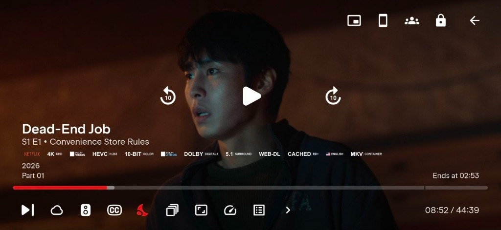
</p>

> **Zero Clipping Guaranteed:** Calibrated with 4px StreamBridge horizontal margins. Even 12+ badges in a single stream (Netflix, 4K UHD, Dolby Vision, HEVC H.265, 10-Bit Color, Dolby Atmos, Dolby Digital+, 5.1 Surround, WEB-DL, CACHED, USA English, MKV Container) fit 100% inside Nuvio's player container with zero edge cutoffs.

---

### 🚀 Performance & Zero-Lag Architecture

Built from the ground up to ensure Nuvio player operates at **maximum frame rates with zero loading latency or memory pressure**:

* **Feather-Light Repository:** The entire 394-badge collection weighs just **2.64 MB** (~6.8 KB per badge).
* **Instant In-Memory Caching:** Any movie or TV stream displays at most 8–12 badges (~50–80 KB total data). Once downloaded, Nuvio caches them in memory instantly.
* **Pre-Rendered 96px Standard:** Every badge is rendered to the exact native 96px canvas height. The player performs **zero on-the-fly resizing or heavy CPU scaling**, guaranteeing butter-smooth 60/120 FPS playback.
* **100% Background-Free (`#00000000`):** Transparent alpha channels with zero artificial drop-shadow blobs or black bounding boxes, eliminating GPU compositing overhead.

---

### 💎 Master Badge Ecosystem

Every streaming platform, Bengali OTT, Indian network, and Hollywood studio is contrast-tuned specifically for dark OLED themes with balanced optical sizing:

<p align="center">
  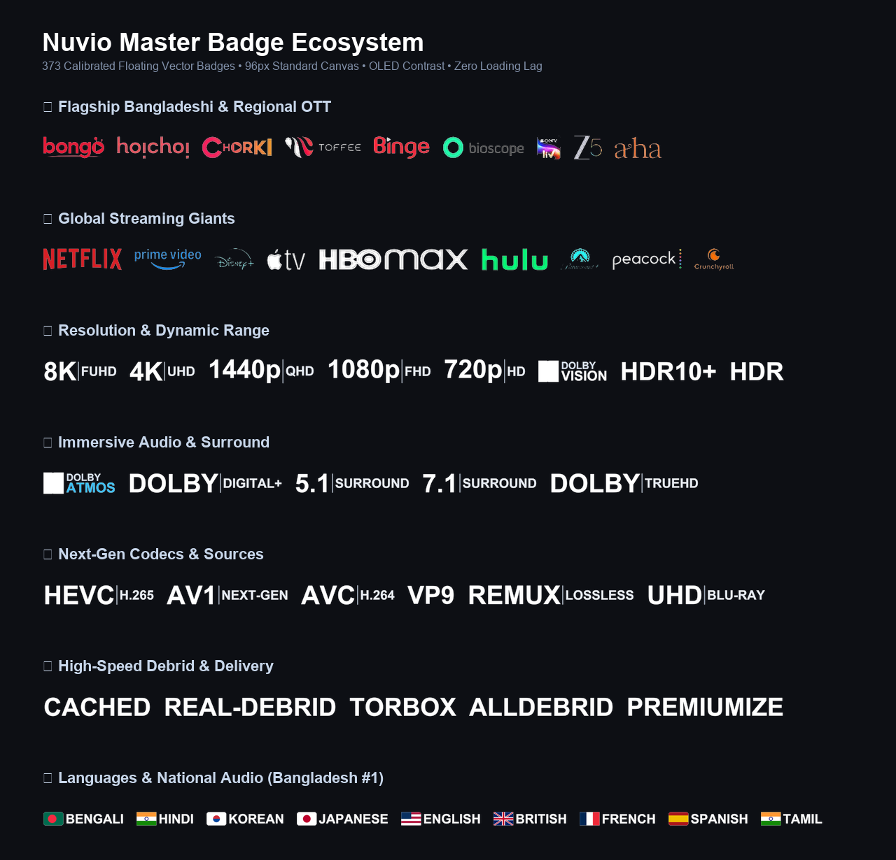
</p>

---

### 🏗️ Architecture & Hierarchy

| # | Group ID | Category | Coverage |
|:-:|:---------|:---------|:---------|
| 1 | `service` | **Streaming & Studios** | Bongo BD, Hoichoi, Chorki, Toffee, Binge BD, Netflix, Prime Video, Disney+, Apple TV+, HBO Max, Hulu, Peacock, Paramount+, Crunchyroll, MUBI, Criterion, JioHotstar, Zee5, SonyLIV, Warner Bros, Universal, Paramount, Columbia, Marvel, DC, Pixar, + 40 more |
| 2 | `resolution` | **Resolution** | 4K UHD, 1080p FHD, 720p HD, 1440p QHD, 8K FUHD, 576p, 480p, SD |
| 3 | `hdr` | **HDR & Vision** | Dolby Vision, HDR10+, HDR10, HDR, HLG, SDR |
| 4 | `depth` | **Color Bit Depth** | 10-bit Color, 8-bit Color, 12-bit Color |
| 5 | `fps` | **Frame Rate** | 60 FPS, 120 FPS, 50 FPS |
| 6 | `codec` | **Video Codecs** | HEVC H.265, AV1 Next-Gen, AVC H.264, VP9, VVC H.266, VC-1, MPEG-2, XVID |
| 7 | `audio` | **Immersive Audio** | Dolby Atmos, Dolby Digital+, 5.1 Surround, 7.1 Surround, TrueHD, DTS-HD MA, DTS:X, Lossless FLAC, AAC, Opus |
| 8 | `source` | **Source & Rips** | REMUX Lossless, UHD Blu-ray, Blu-ray Disc, WEB-DL, WEBRip, HDTV, DVDRip, CAM, TeleSync |
| 9 | `debrid` | **Debrid & Delivery** | CACHED (TorBox, Real-Debrid, AllDebrid, etc.), Real-Debrid, TorBox, AllDebrid, Premiumize, Uncached, Usenet, P2P, Direct Stream, 50GB+ High Bitrate |
| 10 | `edition` | **Editions & Cuts** | IMAX Enhanced, Criterion Collection, Director's Cut, Extended Cut, Theatrical Cut, Remastered, Special Edition |
| 11 | `release` | **Release Flags** | Proper, Repack, Internal, Limited, Season Pack, V2 Revised |
| 12 | `container` | **Containers** | MKV Container, MP4 Container, M2TS Blu-Ray, AVI Container, TS Stream |
| 13 | `subtitle` | **Subtitles** | ESUB English, Multi-Subs, SDH Deaf/HOH, VOSTFR French, Forced Subs |
| 14 | `language` | **Languages & Countries** | 🇧🇩 Bangladesh (#1 Priority), India 🇮🇳, South Korea 🇰🇷, Japan 🇯🇵, USA 🇺🇸, UK 🇬🇧, Canada 🇨🇦, Australia 🇦🇺, New Zealand 🇳🇿, Mexico 🇲🇽, Argentina 🇦🇷, Taiwan 🇹🇼, Hong Kong 🇭🇰, Pakistan 🇵🇰, South Africa 🇿🇦, Nigeria 🇳🇬, Egypt 🇪🇬, Belgium 🇧🇪, Switzerland 🇨🇭, Austria 🇦🇹, Scotland 🏴󠁧󠁢󠁳󠁣󠁴󠁿, Singapore 🇸🇬, Colombia 🇨🇴, Chile 🇨🇱, Morocco 🇲🇦, Portugal 🇵🇹, Brazil 🇧🇷, + 80 more |
| 15 | `live` | **Live TV** | LIVE, 24/7, PPV, HD/SD Feeds, Catch-up |

---

### 🇧🇩 Flagship Bangladeshi & Regional OTT

| Badge | Platform | File | Tag Style |
|:-----:|:---------|:-----|:----------|
|  | **Bongo BD** (Official Vector) | `bongo.webp` | Background-Free |
|  | **Chorki** | `chorki.webp` | Background-Free |
|  | **Hoichoi** | `hoichoi.webp` | Background-Free |
|  | **Toffee** | `toffee.webp` | Background-Free |
|  | **Binge BD** | `bingebd.webp` | Background-Free |
|  | **Bioscope** | `bioscope.webp` | Background-Free |
|  | **SonyLIV** | `sonyliv.webp` | Background-Free |
|  | **Zee5** | `zee5.webp` | Background-Free |
|  | **Aha Video** | `aha.webp` | Background-Free |

---

### 🌐 Global Streaming Giants

| Badge | Platform | File | Tag Style |
|:-----:|:---------|:-----|:----------|
|  | **Netflix** (Official Vector) | `netflix.webp` | Background-Free |
|  | **Prime Video** | `prime.webp` | Background-Free |
|  | **Disney+** | `disney.webp` | Background-Free |
|  | **Apple TV+** | `appletv.webp` | Background-Free |
|  | **Max** | `max.webp` | Background-Free |
|  | **Hulu** | `hulu.webp` | Background-Free |
|  | **Paramount+** | `paramount.webp` | Background-Free |
|  | **Peacock** | `peacock.webp` | Background-Free |
|  | **Crunchyroll** | `crunchyroll.webp` | Background-Free |

---

### 🌍 World Countries & Regional Flags

| Badge | Country / Region | Badge | Country / Region |
|:-----:|:-----------------|:-----:|:-----------------|
|  | **Bangladesh** (Priority #1) |  | **India** |
|  | **Canada** |  | **Australia** |
|  | **New Zealand** | 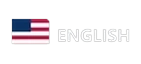 | **USA / English** |
| 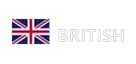 | **United Kingdom** |  | **South Korea** |
| 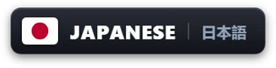 | **Japan** | 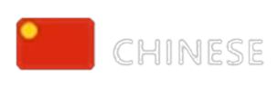 | **China** |
| 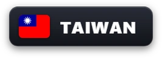 | **Taiwan** |  | **Hong Kong** |
|  | **Mexico** |  | **Argentina** |
|  | **Brazil** |  | **Colombia** |
|  | **Pakistan** |  | **South Africa** |
|  | **Nigeria (Nollywood)** |  | **Egypt** |
|  | **France** |  | **Germany** |
| 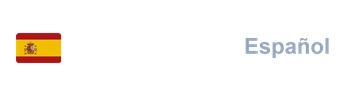 | **Spain** | 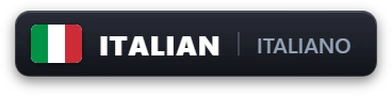 | **Italy** |
|  | **Russia** |  | **Turkey** |
| 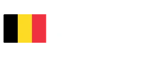 | **Belgium** |  | **Switzerland** |
|  | **Austria** |  | **Scotland** |

---

### 🔬 Technical Specifications

* **Canvas Standard:** `96px` height canvas strictly adhered to for 100% StreamBridge marker standard compatibility.
* **Vector Supersampling:** Text badges and flags rendered from TrueType vector fonts at 4x resolution (384px height) and downsampled with `Lanczos` filtering for buttery-smooth curves with zero jagged artifacts.
* **OLED Contrast Calibration:** Pure `#FFFFFF` radiant white glyphs, `#E1E6F2` high-contrast sub-text, and vivid brand hues without muddy halos or dark drop-shadow smears.
* **100% Background-Free:** Clean transparent alpha channel (`tagColor: #00000000`, `borderColor: "#00000000"`, `tagStyle: "filled"`) — no unwanted black boxes on PC or TV.
* **Zero-Lag Footprint:** The entire 394-badge ecosystem occupies just **2.64 MB** (~6.8 KB average per file), loading in milliseconds with zero memory pressure.

---

<p align="center">
  <sub>Engineered with precision by <a href="https://github.com/jayedanik">@jayedanik</a></sub>
</p>
