<p align="center">
  
</p>

<p align="center">
  <a href="https://github.com/jayedanik/nuvio-badges"></a>
  <a href="badges.json"></a>
  <a href="#theme-universes"></a>
  <a href="badges.json"></a>
  <a href="#performance-architecture"></a>
  <a href="LICENSE"></a>
</p>

<p align="center">
  <sub>Next-generation media stream badge system crafted for Nuvio media player — 395 custom badges across 65+ streaming platforms, cinema studios, 4K/8K formats, spatial audio codecs, and 95 sovereign world languages.<br/>Engineered for pure background-free playback, zero loading latency (~2.6 MB total footprint), and optical TV/PC legibility.</sub>
</p>

---

## Theme Architecture & Ecosystem

Every stream in Nuvio can be experienced across **10 radically distinct physical material universes**. Rather than a static look, choose an aesthetic that matches your personal theater setup:

<p align="center">
  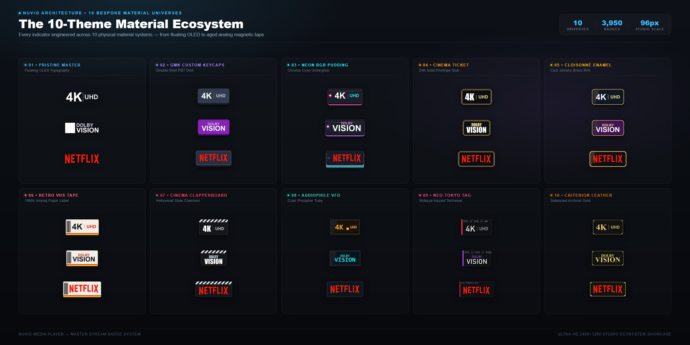
</p>

* **Zero CPU Overhead:** Every theme is pre-rendered at native 96px standard canvas height. Switching themes in Nuvio requires zero re-scaling or image reprocessing.
* **100% Theme Harmonization:** Badges inside every theme (from 4K UHD and Dolby Vision to regional OTTs and Sovereign Flags) follow that theme's exact silhouette, borders, textures, and typography.
* **Streamlined Memory Cache:** The entire multi-theme package is compressed with modern WebP technology, loading in fractions of a millisecond.

---

## Theme Universes

### 01. Pristine Master (Default)
> Ultra-clean floating OLED typography with official Dolby and HDR branding

<p align="center">
  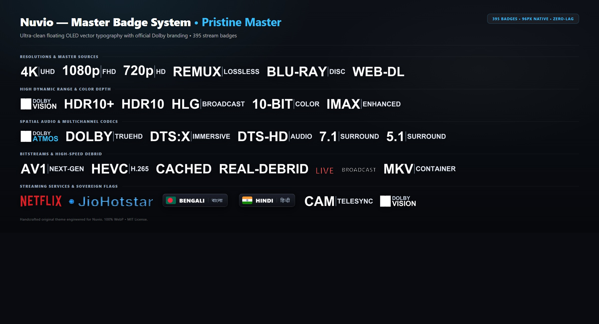
</p>

```text
https://raw.githubusercontent.com/jayedanik/nuvio-badges/main/badges.json
```

---

### 02. GMK Custom Keycaps
> Double-shot mechanical keyboard keycaps with Cherry MX stems & concave dish legends

<p align="center">
  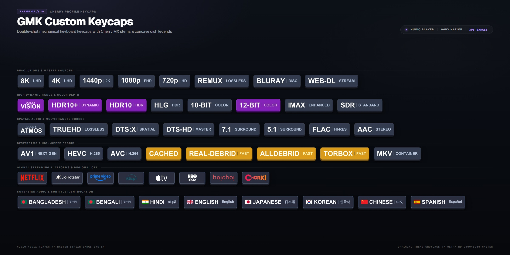
</p>

```text
https://raw.githubusercontent.com/jayedanik/nuvio-badges/main/gmk-keycaps.json
```

---

### 03. Neon RGB Pudding Keycaps
> Translucent frosted pudding keycaps with intense dynamic RGB underglow

<p align="center">
  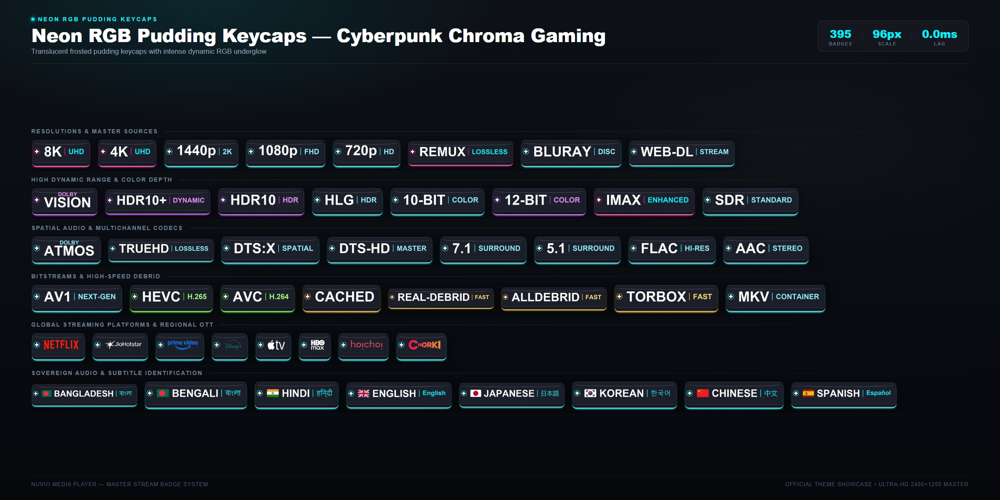
</p>

```text
https://raw.githubusercontent.com/jayedanik/nuvio-badges/main/rgb-keycaps.json
```

---

### 04. Vintage Cinema Ticket
> Authentic perforated box-office admission ticket stubs with 24K gold foil trim

<p align="center">
  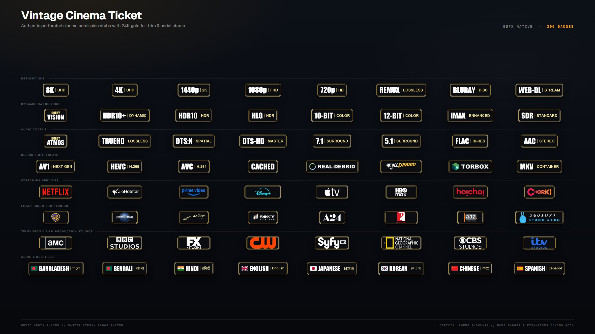
</p>

```text
https://raw.githubusercontent.com/jayedanik/nuvio-badges/main/cinema-ticket.json
```

---

### 05. Cloisonné Enamel Pins
> Handcrafted jewelry metal badges with polished 24K gold brass edging & glossy enamel

<p align="center">
  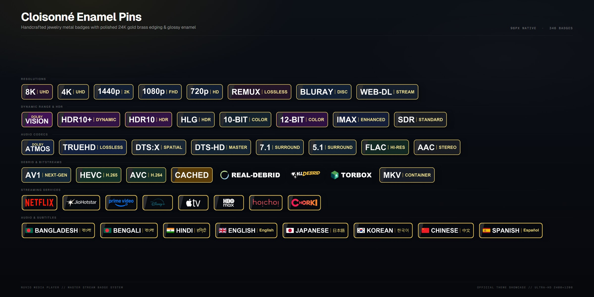
</p>

```text
https://raw.githubusercontent.com/jayedanik/nuvio-badges/main/enamel-pins.json
```

---

### 06. Retro VHS Magnetic Tape
> Authentic 1980s analog magnetic cassette labels with vintage tracking and barcode

<p align="center">
  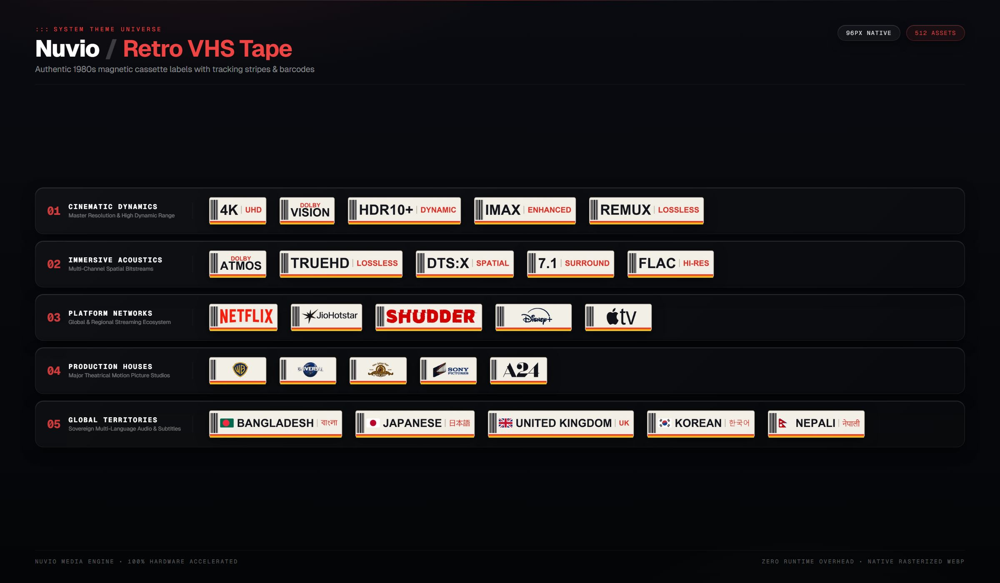
</p>

```text
https://raw.githubusercontent.com/jayedanik/nuvio-badges/main/vhs-tape.json
```

---

### 07. Director Cinema Clapperboard
> Real wooden movie production clapperboard with angled slate diagonal stripes

<p align="center">
  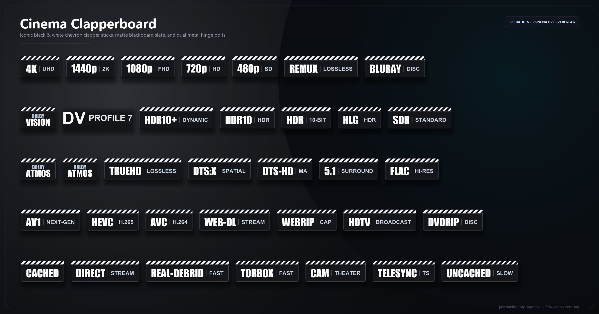
</p>

```text
https://raw.githubusercontent.com/jayedanik/nuvio-badges/main/clapperboard.json
```

---

### 08. Audiophile Vacuum Fluorescent
> Vintage Japanese high-end vacuum fluorescent display with vivid glowing cyan phosphor

<p align="center">
  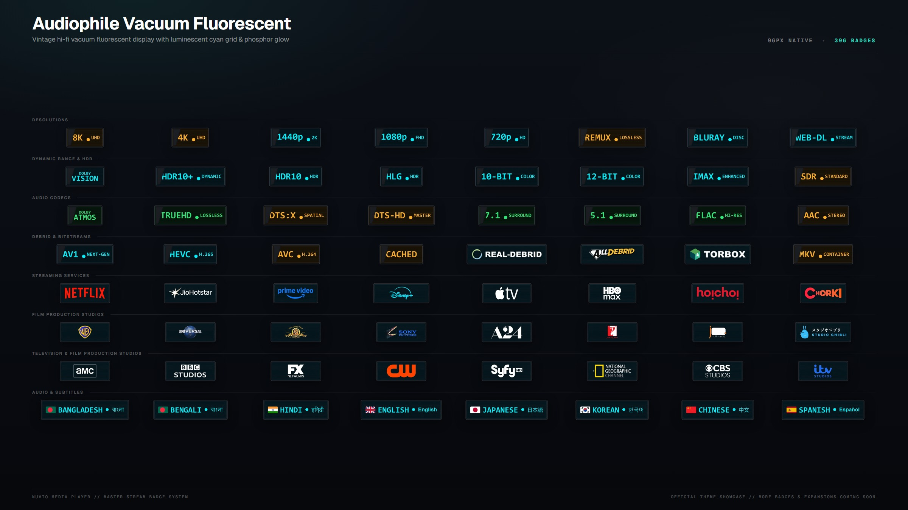
</p>

```text
https://raw.githubusercontent.com/jayedanik/nuvio-badges/main/audiophile-vfd.json
```

---

### 09. Neo-Tokyo Cyberpunk Tag
> Distressed industrial cyberpunk inspection tags with hazard accents

<p align="center">
  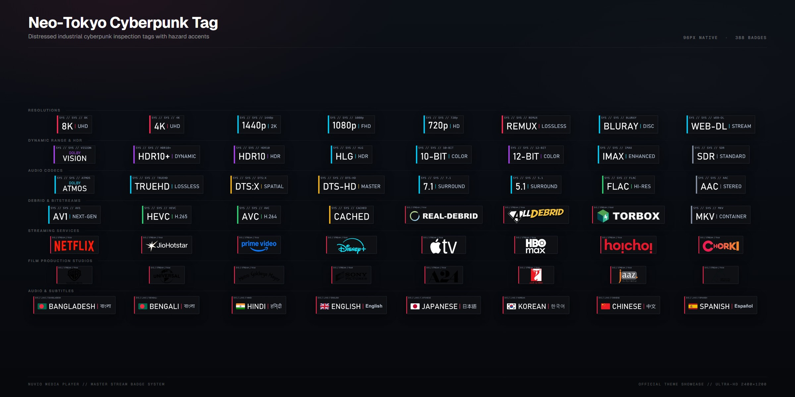
</p>

```text
https://raw.githubusercontent.com/jayedanik/nuvio-badges/main/neotokyo-tag.json
```

---

### 10. Criterion Archival Leather
> Luxurious hand-stitched archival leather binding with genuine 24K gold foil stamping

<p align="center">
  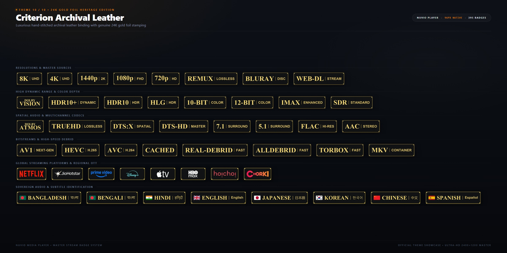
</p>

```text
https://raw.githubusercontent.com/jayedanik/nuvio-badges/main/criterion-leather.json
```

---

## Performance Architecture

Built from the ground up to ensure Nuvio player operates at **maximum frame rates with zero loading latency or memory pressure**:

* **Feather-Light Footprint:** The entire 395-badge collection weighs just **2.64 MB** (~6.8 KB average per badge).
* **Instant In-Memory Caching:** Any movie or TV stream displays at most 8–12 badges (~50–80 KB total data). Once downloaded, Nuvio caches them in memory instantly.
* **Pre-Rendered 96px Standard:** Every badge is rendered to the exact native 96px canvas height. The player performs **zero on-the-fly resizing or heavy CPU scaling**, guaranteeing butter-smooth 60/120 FPS playback.
* **100% Background-Free (`#00000000`):** Transparent alpha channels with zero artificial drop-shadow blobs or black bounding boxes, eliminating GPU compositing overhead.

---

## Regional Streaming Platforms

| Badge | Platform | File | Status |
|:-----:|:---------|:-----|:-------|
|  | **Chorki** | `chorki.webp` | Native Master |
|  | **Hoichoi** | `hoichoi.webp` | Native Master |
|  | **Binge** | `binge.webp` | Native Master |
|  | **Toffee** | `toffee.webp` | Native Master |
|  | **Bioscope** | `bioscope.webp` | Native Master |
|  | **Bongo BD** | `bongo.webp` | Native Master |
|  | **JioHotstar** | `jiohotstar.webp` | Native Master |
|  | **JioCinema** | `jiocinema.webp` | Native Master |
|  | **ZEE5** | `zee5.webp` | Native Master |
|  | **Sony LIV** | `sonyliv.webp` | Native Master |

---

## Global Streaming Platforms

| Badge | Platform | File | Status |
|:-----:|:---------|:-----|:-------|
|  | **Netflix** | `netflix.webp` | Native Master |
|  | **Prime Video** | `prime.webp` | Native Master |
|  | **Disney+** | `disney.webp` | Native Master |
|  | **Apple TV+** | `appletv.webp` | Native Master |
|  | **HBO Max** | `max.webp` | Native Master |
|  | **Paramount+** | `paramount.webp` | Native Master |
|  | **Hulu** | `hulu.webp` | Native Master |
|  | **Peacock** | `peacock.webp` | Native Master |
|  | **Crunchyroll** | `crunchyroll.webp` | Native Master |

---

## Technical Specifications

| Parameter | Specification | Purpose |
|:----------|:--------------|:--------|
| **Master Canvas Height** | 96 px Standard | Universal fixed vertical baseline for TV & Mobile UI |
| **Output Image Format** | Lossless / Near-Lossless WebP | Ultra-lightweight bytes (~6.8 KB average) |
| **Alpha Channel** | Full Transparency (`#00000000`) | Seamless integration over dynamic backdrop art |
| **Typography Standard** | Geometric Sans (`Inter` / `JetBrains Sans`) | Maximum legibility from 10-foot viewing distance |
| **Sovereign Flag Geometry** | Math-accurate constitutional ratios | Zero distorted national symbols |
| **Theme Silhouettes** | 10 Physical Universes | Hardware, artisan jewelry, retro synthwave & cinema |

---

<p align="center">
  <sub>Crafted with passion for the global Nuvio media community • Licensed under MIT</sub>
</p>
