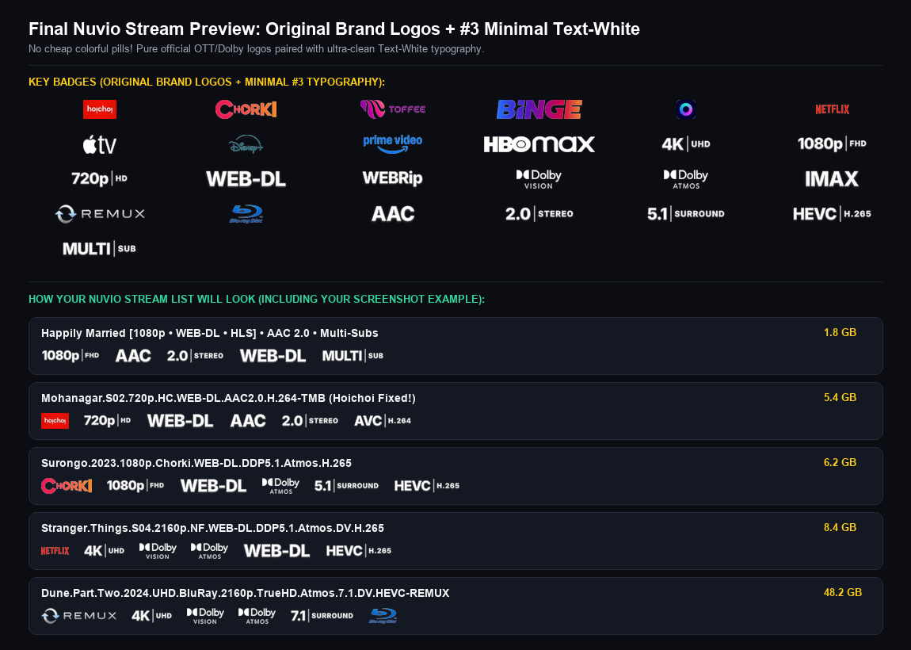
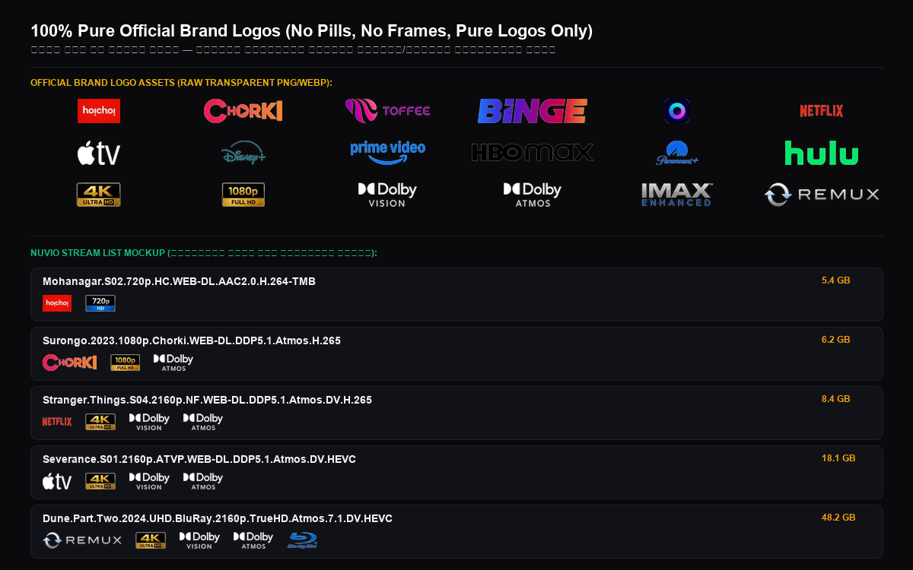

# 🎬 Nuvio Original & Minimal Stream Badge Kit

An authentic, ultra-clean stream badge kit for **Nuvio** media player, featuring **official transparent brand logos**, **Bangladeshi & Regional OTT platforms**, and sleek **minimalist typography** (no cheap colorful pills!).

---

## ⚡ Quick Setup for Nuvio

Copy and paste this raw JSON URL into your Nuvio settings:

```text
https://raw.githubusercontent.com/jayedanik/nuvio-badges/main/badges.json
```

### 📱 How to Apply:
1. Open **Nuvio** on your Android TV, Firestick, Mobile, or Desktop.
2. Navigate to **Settings** ➔ **Layout** ➔ **Streams** ➔ **Fusion Badge URLs** (or **Badge URLs**).
3. Paste the URL above and save.
4. Restart Nuvio or refresh your stream list!

---

## 📸 Preview Showcase

### 1. In-App Stream List Appearance
Authentic transparent OTT logos paired with ultra-clean Text-White metadata:



---

### 2. Official Brand Logos
100% original, untouched vector brand marks without fake boxes or pill wrappers:



---

### 3. Complete Master Badge Catalog (265+ Badges)
Categorized across Streaming, Resolutions, HDR, Audio, Sources, Codecs, and Languages:


---

## ✨ Features & Highlights

- **🇧🇩 Full Bangladeshi & Regional OTT Support:**
  - **Hoichoi** (bulletproof regex matching `hoichoi`, `HC.WEB-DL`, `[HC]`, `hmp`)
  - **Chorki**
  - **Toffee**
  - **Binge BD**
  - **Bioscope**
  - Plus JioHotstar, Zee5, SonyLIV, SunNXT, Aha, and more!
- **🌐 Global Streaming Platforms:**
  - Official high-resolution transparent logos for **Netflix**, **Apple TV+**, **Disney+**, **Prime Video**, **HBO Max**, **Hulu**, **Paramount+**, **Peacock**, **Crunchyroll**, and more.
- **🎧 Studio Audio & Visual Badges:**
  - Official badges for **Dolby Vision**, **Dolby Atmos**, **Dolby TrueHD**, **IMAX Enhanced**, **DTS:X**, **DTS-HD Master Audio**, **REMUX**, and **Blu-ray Disc**.
- **💎 Clean Minimal Typography (Text-White):**
  - Replaces childish, colorful pill boxes with sleek, legible white typography for resolutions (`4K UHD`, `1080p FHD`, `720p HD`), codecs (`HEVC`, `AVC`, `AV1`), audio channels (`2.0 STEREO`, `5.1`, `7.1`), and sources (`WEB-DL`, `WEBRip`).

---

## 📄 License & Credits
- Badge kit maintained by [@jayedanik](https://github.com/jayedanik).
- Brand logos and trademarks belong to their respective copyright holders.
