<p align="center">
  
</p>

<p align="center">
  <a href="https://github.com/jayedanik/nuvio-master-badge-system"></a>
  <a href="badges.json"></a>
  <a href="badges/"></a>
  <a href="#theme-universes"></a>
  <a href="badges.json"></a>
  <a href="#performance-architecture"></a>
  <a href="LICENSE"></a>
</p>

<p align="center">
  <sub>Next-generation media stream badge system crafted for Nuvio media player — 396 curated stream badges (509 master WebP assets with fallbacks & aliases) across 19 specialized groups: 73 streaming platforms, 67 film & television studios, 4K/8K formats, spatial audio codecs, high-speed Debrid services, torrent indexers, and 110 sovereign world languages and territories.<br/>Engineered for pure background-free playback, zero loading latency (~3.1 MB total footprint), and calibrated compact proportions for overflow-free TV, PC, and mobile viewing.</sub>
</p>

---

## Theme Architecture & Ecosystem

Every stream in Nuvio can be experienced across **11 radically distinct physical material universes**. Rather than a static look, choose an aesthetic that matches your personal theater setup:

<p align="center">
  
</p>

* **Zero CPU Overhead:** Every theme is pre-rendered at native 96px standard canvas height. Switching themes in Nuvio requires zero re-scaling or image reprocessing.
* **100% Theme Harmonization:** Badges inside every theme (from 4K UHD and Dolby Vision to regional OTTs and Sovereign Flags) follow that theme's exact silhouette, borders, textures, and typography.
* **Calibrated Zero-Clipping Proportions:** Laser-balanced aspect ratios ensure that even heavy 13+ stream rows (resolutions, multi-codecs, spatial audio, OTT, debrid, and languages) render seamlessly without container clipping or edge cutoff on any screen.
* **Streamlined Memory Cache:** The entire multi-theme package is compressed with modern WebP technology, loading in fractions of a millisecond.

---

## Theme Universes

### Pristine Master (Default)
> Ultra-clean floating OLED typography with official Dolby and HDR branding

<p align="center">
  
</p>

```text
https://raw.githubusercontent.com/jayedanik/nuvio-master-badge-system/main/badges.json
```

---

### StreamBridge Studio Markers Enhanced
> Enhanced frameless studio production markers with prismatic HDR spectrum & metallic accents

<p align="center">
  
</p>

```text
https://raw.githubusercontent.com/jayedanik/nuvio-master-badge-system/main/studio-markers.json
```

---

### GMK Custom Keycaps
> Double-shot mechanical keyboard keycaps with Cherry MX stems & concave dish legends

<p align="center">
  
</p>

```text
https://raw.githubusercontent.com/jayedanik/nuvio-master-badge-system/main/gmk-keycaps.json
```

---

### Neon RGB Pudding Keycaps
> Translucent frosted pudding keycaps with intense dynamic RGB underglow

<p align="center">
  
</p>

```text
https://raw.githubusercontent.com/jayedanik/nuvio-master-badge-system/main/rgb-keycaps.json
```

---

### Vintage Cinema Ticket
> Authentic perforated box-office admission ticket stubs with 24K gold foil trim

<p align="center">
  
</p>

```text
https://raw.githubusercontent.com/jayedanik/nuvio-master-badge-system/main/cinema-ticket.json
```

---

### Cloisonné Enamel Pins
> Handcrafted jewelry metal badges with polished 24K gold brass edging & glossy enamel

<p align="center">
  
</p>

```text
https://raw.githubusercontent.com/jayedanik/nuvio-master-badge-system/main/enamel-pins.json
```

---

### Retro VHS Magnetic Tape
> Authentic 1980s analog magnetic cassette labels with vintage tracking and barcode

<p align="center">
  
</p>

```text
https://raw.githubusercontent.com/jayedanik/nuvio-master-badge-system/main/vhs-tape.json
```

---

### Director Cinema Clapperboard
> Real wooden movie production clapperboard with angled slate diagonal stripes

<p align="center">
  
</p>

```text
https://raw.githubusercontent.com/jayedanik/nuvio-master-badge-system/main/clapperboard.json
```

---

### Audiophile Vacuum Fluorescent
> Vintage Japanese high-end vacuum fluorescent display with vivid glowing cyan phosphor

<p align="center">
  
</p>

```text
https://raw.githubusercontent.com/jayedanik/nuvio-master-badge-system/main/audiophile-vfd.json
```

---

### Neo-Tokyo Cyberpunk Tag
> Distressed industrial cyberpunk inspection tags with hazard accents

<p align="center">
  
</p>

```text
https://raw.githubusercontent.com/jayedanik/nuvio-master-badge-system/main/neotokyo-tag.json
```

---

### Criterion Archival Leather
> Luxurious hand-stitched archival leather binding with genuine 24K gold foil stamping

<p align="center">
  
</p>

```text
https://raw.githubusercontent.com/jayedanik/nuvio-master-badge-system/main/criterion-leather.json
```

---

## Performance Architecture

Built from the ground up to ensure Nuvio player operates at **maximum frame rates with zero loading latency or memory pressure**:

* **Feather-Light Footprint:** Exactly **396 stream filter rules** backed by **509 master WebP assets** weighing just **3.12 MB** (~6.8 KB average per badge).
* **Instant In-Memory Caching:** Any movie or TV stream displays at most 6–8 badges (~40–60 KB total data). Once downloaded, Nuvio caches them in memory instantly.
* **100% In-App Counter Synchronization:** Mapped across 19 distinct groups (with dedicated Film Production Studios followed immediately by Television & Film Production Studios), aligning 1:1 with Nuvio's in-app badge counter (exactly 396 enabled badges) while guaranteeing fallback support with 509 high-resolution WebP files and aliases.
* **Pre-Rendered 96px Standard:** Every badge is rendered to the exact native 96px canvas height with calibrated horizontal margins. The player performs zero on-the-fly resizing or heavy CPU scaling, guaranteeing butter-smooth 60/120 FPS playback.
* **Zero Player Clipping Guarantee:** Intelligent deduplication regex filters (e.g. prioritizing Dolby Vision over generic HDR, and Dolby Atmos over DDP) eliminate visual redundancy and prevent horizontal container overflow or edge cutoff across Mobile, Tablet, PC, and 4K TV screens.
* **100% Background-Free (`#00000000`):** Transparent alpha channels with zero artificial drop-shadow blobs or black bounding boxes, eliminating GPU compositing overhead.

---

## High-Speed Debrid Services

| Badge | Service | File | Status |
|:-----:|:--------|:-----|:-------|
| 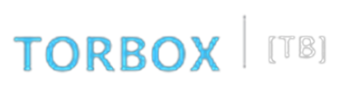 | **TorBox** | `torbox.webp` | Official Vector Logo |
|  | **Real-Debrid** | `realdebrid.webp` | Official Shield Logo |
| 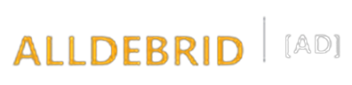 | **AllDebrid** | `alldebrid.webp` | Official Infinity Cloud Logo |
| 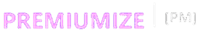 | **Premiumize** | `premiumize.webp` | Official Cloud Logo |
|  | **Debrid-Link** | `debridlink.webp` | Official Brand Logo |

---

## Torrent Trackers & Indexers

| Badge | Tracker / Indexer | File | Status |
|:-----:|:------------------|:-----|:-------|
|  | **1337x** | `1337x.webp` | Official Wordmark Logo |
| 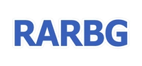 | **RARBG** | `rarbg.webp` | Official Shield Logo |
|  | **The Pirate Bay** | `piratebay.webp` | Official Galleon Ship Logo |
|  | **YTS / YIFY** | `yts.webp` | Official Film Reel Logo |
| 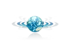 | **EZTV** | `eztv.webp` | Official TV Antenna Logo |
| 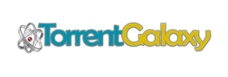 | **TorrentGalaxy (TGx)** | `torrentgalaxy.webp` | Official Cosmic Wordmark |
|  | **RuTracker** | `rutracker.webp` | Official Globe Logo |
|  | **Nyaa** | `nyaa.webp` | Official Anime Mascot Logo |

---

## Film Production Studios

Arranged in Nuvio to display immediately after streaming platforms for authentic theatrical presentation:

| Sector | Studios & Production Houses |
|:-------|:----------------------------|
| **Hollywood** | Warner Bros., Universal, MGM, Sony Pictures, A24, Paramount, Columbia, Disney Studio, Marvel, DC, Lucasfilm, Pixar, DreamWorks, 20th Century Studios, Lionsgate, Neon, Blumhouse, Focus Features, Searchlight, Legendary, New Line Cinema, Miramax, TriStar, StudioCanal, Illumination, Skydance, Bad Robot, Amblin |
| **Bollywood & South India** | Yash Raj Films (YRF), Dharma Productions, T-Series, Red Chillies, Zee Studios, Maddock Films, Nadiadwala Grandson, Excel Entertainment, Hombale Films, Mythri Movie Makers, Geetha Arts, DVV Entertainment, Lyca Productions, Sun Pictures |
| **Bangladesh Cinema** | Jaaz Multimedia, Impress Telefilm, Alpha-i Studios, Film Syndicate, Tiger Media, Action Cut Entertainment, Monsoon Films, Shapla Media, Bengal Multimedia, SVF |
| **World Cinema** | Studio Ghibli (Japan), Toho (Japan), Toei Company (Japan), CJ ENM (Korea), Showbox (Korea), Gaumont (France), Pathé (France/UK) |
| **Television & Streaming Powerhouses** | AMC Networks / Studios, BBC Studios, FX Productions, Showtime, Starz, The CW, Syfy, National Geographic, CBS Studios, ITV Studios |

---

## Regional Streaming Platforms

| Badge | Platform | File | Status |
|:-----:|:---------|:-----|:-------|
|  | **Chorki** | `chorki.webp` | Native Master |
|  | **Hoichoi** | `hoichoi.webp` | Native Master |
| 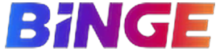 | **Binge** | `binge.webp` | Native Master |
| 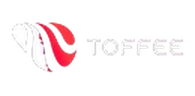 | **Toffee** | `toffee.webp` | Native Master |
| 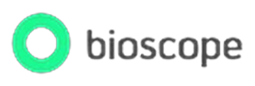 | **Bioscope** | `bioscope.webp` | Native Master |
| 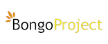 | **Bongo BD** | `bongo.webp` | Native Master |
|  | **JioHotstar** | `jiohotstar.webp` | Native Master |
| 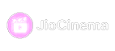 | **JioCinema** | `jiocinema.webp` | Native Master |
| 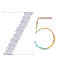 | **ZEE5** | `zee5.webp` | Native Master |
| 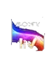 | **Sony LIV** | `sonyliv.webp` | Native Master |

---

## Global Streaming Platforms

| Badge | Platform | File | Status |
|:-----:|:---------|:-----|:-------|
|  | **Netflix** | `netflix.webp` | Native Master |
|  | **Prime Video** | `prime.webp` | Native Master |
| 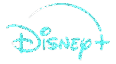 | **Disney+** | `disney.webp` | Native Master |
|  | **Apple TV+** | `appletv.webp` | Native Master |
|  | **HBO Max** | `max.webp` | Native Master |
| 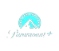 | **Paramount+** | `paramount.webp` | Native Master |
|  | **Hulu** | `hulu.webp` | Native Master |
|  | **Peacock** | `peacock.webp` | Native Master |
| 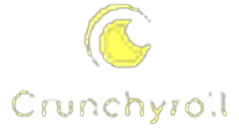 | **Crunchyroll** | `crunchyroll.webp` | Native Master |

---

---

## Upcoming Badges

The Nuvio Master Badge System is in continuous, active development. More new stream badges and expansions are coming soon across future drops.

---

## Technical Specifications

| Parameter | Specification | Purpose |
|:----------|:--------------|:--------|
| **Master Canvas Height** | 96 px Standard | Universal fixed vertical baseline for TV & Mobile UI |
| **Output Image Format** | Lossless / Near-Lossless WebP | Ultra-lightweight bytes (~6.8 KB average) |
| **Alpha Channel** | Full Transparency (`#00000000`) | Seamless integration over dynamic backdrop art |
| **Typography Standard** | Geometric Sans (`Inter` / `JetBrains Sans`) | Maximum legibility from 10-foot viewing distance |
| **Sovereign Flag Geometry** | Math-accurate constitutional ratios | Zero distorted national symbols |
| **Theme Silhouettes** | 10 Physical Universes | Hardware, artisan jewelry, retro synthwave & cinema |

---

<p align="center">
  <sub>Crafted with passion for the global Nuvio media community • Licensed under MIT</sub>
</p>
